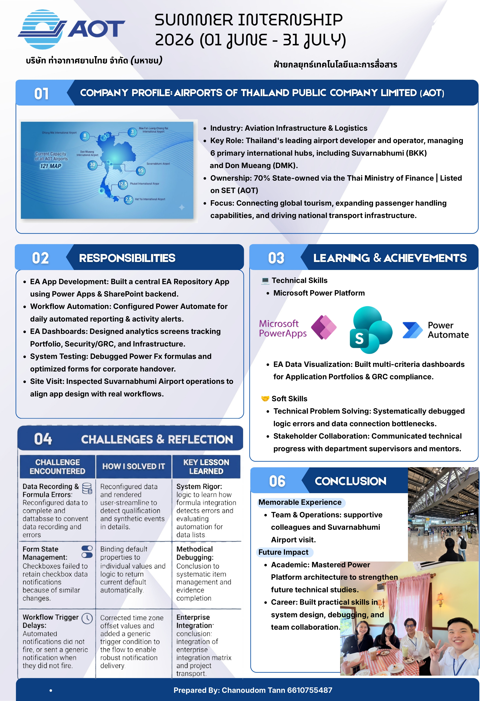

# Enterprise Architecture Repository (EA Repository) — Low-Code Platform

An enterprise-grade tracking, management, and business intelligence reporting application developed for **Airports of Thailand Public Company Limited (AOT)** during a summer internship within the **Technology and Communications Strategy Department (ฝ่ายกลยุทธ์เทคโนโลยีและการสื่อสาร)**.

The system streamlines IT inventory management, operational workflows, alignment mapping, and executive dashboard analytics across AOT's enterprise architecture.

---

## Project Overview

- **Organization:** Airports of Thailand Public Company Limited (AOT)
- **Department:** Technology and Communications Strategy Department
- **Developer:** Chanoudom Tann
- **Duration:** June 1, 2026 – July 31, 2026 (37 working days / 333 hours)
- **Academic Context:** Electrical and Data Engineering (TEPE), Thammasat University

---

## Documentation & Assets

- **Documentation Package:** [Download Technical Report & Assets (ZIP)](./report.zip) — Complete package containing the 18-page technical report detailing project implementation phases, low-code architecture, problem decomposition, and future system recommendations.

---

## Key Features

### 1. Centralized Data Entry & Form Management
- **Authentication & Access:** Secure login module with session management.
- **Application Registry:** Comprehensive data collection for enterprise applications, organizational units (โครงสร้างฝ่าย), and operational dependencies.
- **State Management:** Custom check-box logic, dynamic drop-downs, and real-time record editing with validation rules.

### 2. Workflow Automation
- **Event Alerts:** Automated login notifications and event triggers built via Power Automate.
- **Daily Status Reporting:** Scheduled automated daily activity reports sent via Microsoft Outlook at 17:30.

### 3. Executive Dashboards & Analytics
- **IT Inventory Overview:** Real-time visibility into active, under-development, high-priority, and PDPA-related systems.
- **Application Portfolio Report:** Filtered views detailing application categories and system types.
- **Business Alignment Report:** Strategy mapping showing how digital applications support overarching corporate objectives.
- **Security & GRC Report:** Monitoring metrics for Governance, Risk, and Compliance.
- **Data & PDPA Compliance Report:** Tracking systems containing personally identifiable information (PII) to align with data privacy regulations.
- **Infrastructure & Digital Tech Reports:** Visualizations tracking underlying platform infrastructure and technology stack distributions.

---

## Tech Stack & Tools

- **Frontend / App Framework:** Microsoft Power Apps (Canvas Apps, Power Fx formulas, custom UI/UX design)
- **Backend / Database:** SharePoint Lists (Relational cloud database structure, schema mapping)
- **Automation Engine:** Microsoft Power Automate & Microsoft Outlook Integration
- **UI Prototyping & Flow Design:** Figma

---

## Technical Challenges & Solutions

| Issue / Challenge | Root Cause | Solution Implemented |
| :--- | :--- | :--- |
| **Data Submission Errors** | Connection mismatches and unvalidated required fields in Power Apps form cards. | Reconfigured data mapping, overhauled patch formulas, and added strict field validation. |
| **Checkbox State Issues** | Conflicts between `Default` items and reset properties across form components. | Re-bound control formulas, updated `Default` bindings, and tested state behaviors thoroughly. |
| **Workflow Delays** | Time-zone offset discrepancies and trigger condition mismatches in Power Automate. | Corrected recurrence schedules, adjusted time zones to UTC+7, and set proper trigger conditions. |

---

## Future Enhancements

1. **Role-Based Access Control (RBAC):** Implement granular access tiers to restrict administrative editing based on user department level.
2. **Power BI Analytics:** Connect the SharePoint backend directly to Power BI for advanced predictive modeling and dynamic corporate visualizations.
3. **Automated Error Logging:** Create a dedicated log list in SharePoint to automatically track runtime exceptions.
